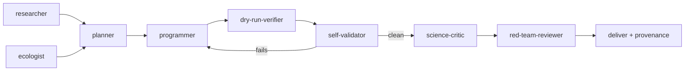

# graph audit of my agent system

date: 2026-11-14. read only, nothing changed.

Method is from Austin Marchese's graph engineering video: draw each workflow as nodes and hand-offs, run the wait test on every edge ("does this step actually need the result of the one before it?"), then look for places a diamond, a branch, or a capped loop fits.

## what was read

Read in full: `agent-pipeline`, `pr-review`, `slack-triage`, `red-team-review`, `dry-run-verify`, `run-record`, `human-voice` skills; `self-validator`, `researcher`, `pr-reviewer`, `red-team-reviewer` agents; `post-edit.sh`, `test-gate.sh`, the prompt-refine hook script, `settings.json`; `crontab -l` (empty).

Read by description line only: the other 17 skills and 8 agents, and the first 40 lines of `guard-bash.sh`.

Not read: a triage refresh script, the desktop app's scheduled tasks, the claude.ai connectors. Loops or hand-offs living there are not in this audit.

## the system as a graph

Three real workflows, plus four hooks that sit on every turn.

**agent-pipeline** (8 stages, one orchestrator):

Mostly a chain. One small diamond already exists (researcher and ecologist launch together), one loop (self-validator back to programmer), and stages 6 and 7 are allowed to run together "when the deliverable is final-shaped".

**pr-review**: resolve PR, fetch, read, run, combined lens (four reviewers in one context), red team, write one `.md`, human-voice pass. A pure chain; the `pr-reviewer` agent is told not to spawn anything.

**slack-triage**: read, draft, write to the sheet, hand over. A pure chain.

**hooks**: `prompt-refine` on every prompt, `guard-bash` before every Bash call, `post-edit` after every Write or Edit. `test-gate` exists but is not registered.

## 1. wait test

| edge | needs the previous result? | verdict |
|---|---|---|
| researcher, ecologist -> planner | No. The planner "sweeps the code/data end to end"; the skill has the orchestrator reconcile it with stage 1 afterwards. | Run all three together. |
| planner -> programmer | Yes, it codes to the spec. | Keep. |
| programmer -> dry-run -> self-validator | Yes, each tests the artifact before it. | Keep. |
| self-validator -> science-critic | Yes, critique wants validated work. | Keep. |
| science-critic -> red-team-reviewer | Only partly. Red team re-derives from source, it does not read the critique. It does need the artifact to be final. | Together when the critique is expected to change wording, not substance. The skill already says this; it is just not the default. |
| red team -> provenance | No. The run record needs the run's config, versions and seed, none of which the review changes. | Write the run record as soon as the production run ends, alongside review. |
| pr-review: fetch title, diff, file list, existing threads | No, four independent reads. | One message, four calls. |
| pr-review: load 5 voice files + 2 skills -> fetch PR | No. | Together with the fetch. |
| pr-review: read -> run | Yes, the read finds the entry point. | Keep. |
| pr-review: lens -> red team | No. Both read the same diff and run transcript. | Together, from the main loop only (see caveat). |
| slack-triage: read channel A -> read channel B | No. | Parallel tool calls; no subagents needed. |
| slack-triage: read -> draft -> sheet | Yes. | Keep. |

Also found while drawing it: `style-reviewer` and `source-verifier` are in the pipeline's role map but no stage calls them. They are nodes with no edge in.

## 2. where a diamond fits

| place | fan out | merge | change that makes it happen |
|---|---|---|---|
| pipeline stage 1 | one researcher per angle (mechanism, method, published value, tool docs), plus ecologist, plus planner | orchestrator reconciles into the plan | change stage 1 to launch N researchers by angle and move the planner's sweep into the same message |
| claim checking | one `source-verifier` per claim, from the claim list red team step 1 already writes | one confirmed / plausible / refuted table | add a "verify claims" stage that takes a claim list and fans out; this is rule 7 made mechanical |
| final review | `science-critic`, `red-team-reviewer`, and `style-reviewer` when there is an R diff | orchestrator applies the union, once | make stage 6 and 7 parallel by default and give `style-reviewer` an edge in |
| PR review | four lenses (correctness, maintainer, library author, project lead) as four readers | one synthesis node that keeps at most one should-fix and a couple of nits | only in the main-loop path; leave the one-shot `pr-reviewer` agent as it is |
| vault ingest | one reader per new source | one index and log update | part of the vault build |

Caveats that matter here:

- False independence. Angle-split researchers will overlap unless each brief says what the others cover. Every fan-out brief needs a "not your job" line.
- Silent failure. A fan-out that loses one worker still returns something. The merge node has to state how many workers reported, and name the missing one.
- PR review fan-out fights two things already on record: spawned readers that should stay read only, and my review standard of short comments with one real should-fix. Four readers produce more findings, not better ones, so the synthesis node carries the weight. Low priority.

## 3. where a branch fits (five routes or fewer)

| router | routes | replaces |
|---|---|---|
| `/review` | PR number -> `pr-review`; R diff -> `style-reviewer`; a claim or number -> `source-verifier`; a result or diagnosis -> `red-team-review`; a doc for the team -> `science-critic` | remembering which of five reviewers to call |
| `/voice` | personal (default), technical, strip-tells-only | `personal-writing`, `technical-writing`, `human-voice`, which already describe themselves as counterparts of each other |
| `/improve-system` | audit the setup as a graph; turn a correction into a rule or hook; mine session history for repeated asks; consolidate memory | nothing yet, this is new. Memory index is at 19.9 of 25 KB, so the fourth route has work waiting. |
| `/verification-loop` | code -> tests or dry run; number -> source check; prose -> tell check; doc -> technical-writing review | choosing a verifier by hand |

Not recommended yet: merging `r-coding-style`, `r-package-style` and `r-dev` behind one router. They overlap by description, but I have not read the three in full, and two of them are long. Worth a separate look.

## 4. loops and their caps

| loop | where | cap today | proposed cap |
|---|---|---|---|
| self-validator <-> programmer | `agent-pipeline` stage 5, `self-validator.md` step 3 | none. Stops "when a full pass is clean, or when remaining failures are precisely characterized". | 3 full passes. On a failing third pass, stop and report the remaining failures as characterized. |
| "if yes, keep going" | `human-voice`, `personal-writing`, `pr-review` last pass | none, and the check is a judgment | 2 rewrites, and swap the judgment for the grep `post-edit.sh` already runs plus the tell-word list |
| `test-gate.sh` stop hook | not registered | none. It exits 2 every time tests fail and never checks whether it already blocked once. | before enabling: block once, then let the turn end with the failure stated. Confirm the `stop_hook_active` field against the hooks docs when editing. |
| `post-edit.sh` feedback | every Write or Edit | none. A file that must keep an em dash (a verbatim quote) gets flagged on every edit. | no cap needed; add a per-file opt-out marker for verbatim sources |

No `/loop`, no cron, no scheduled cloud task found (crontab is empty; desktop scheduled tasks not checked).

## what is already right

- The pipeline already tells each agent to get "only the context it needs" and to return conclusions, which is the fix for most diamond failures.
- Every reviewer agent is read only, so a failed fan-out worker cannot damage anything. Cost of error is low, which is the condition the video sets for fanning out.
- Hard rules about pushing and posting are already in `guard-bash.sh`, not only in prose.
